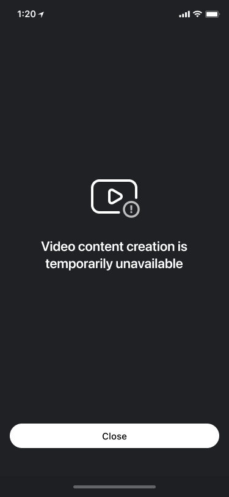

# Quickstart Guide

- [Installation](#Installation)
- [AndroidManifest.xml Updates](#AndroidManifest-updates)
- [Initialize SDK](#Initialize-SDK)
- [Customization options](#Customization-options)

## Installation  
Add the Banuba repository to your project using **either** Groovy **or** Kotlin DSL:

**Groovy** (in project's [build.gradle](../build.gradle#L21))

```groovy
...

allprojects {
    repositories {
       ...
       maven {
          name = "nexus"
          url = uri("https://nexus.banuba.net/repository/maven-releases")
       }
    }
}
```
or 

**Kotlin** (settings.gradle.kts)
```kotlin
...
dependencyResolutionManagement {
   repositoriesMode.set(RepositoriesMode.FAIL_ON_PROJECT_REPOS)
   repositories {
      ...
      maven {
         name = "nexus"
         url = uri("https://nexus.banuba.net/repository/maven-releases")
      }
   }
}
```

Add ```packagingOptions``` to your app's [gradle](../app/build.gradle#L46-L53)
```groovy
android {
...
   packagingOptions {
      pickFirst '**/libbanuba-ve-yuv.so'

      jniLibs {
         useLegacyPackaging = true
      }
   }
...
}
```

Add dependencies to your app's [gradle](../app/build.gradle#L66)

```groovy
    def banubaSdkVersion = '1.55.0'

    implementation "com.banuba.sdk:ffmpeg:5.3.0"
    implementation "com.banuba.sdk:camera-sdk:${banubaSdkVersion}"
    implementation "com.banuba.sdk:camera-ui-sdk:${banubaSdkVersion}"
    implementation "com.banuba.sdk:core-sdk:${banubaSdkVersion}"
    implementation "com.banuba.sdk:core-ui-sdk:${banubaSdkVersion}"
    implementation "com.banuba.sdk:ve-flow-sdk:${banubaSdkVersion}"
    implementation "com.banuba.sdk:ve-sdk:${banubaSdkVersion}"
    implementation "com.banuba.sdk:ve-ui-sdk:${banubaSdkVersion}"
    implementation "com.banuba.sdk:ve-gallery-sdk:${banubaSdkVersion}"
    implementation "com.banuba.sdk:ve-effects-sdk:${banubaSdkVersion}"
    implementation "com.banuba.sdk:effect-player-adapter:${banubaSdkVersion}"
    implementation "com.banuba.sdk:ar-cloud:${banubaSdkVersion}"
    implementation "com.banuba.sdk:ve-audio-browser-sdk:${banubaSdkVersion}"
    implementation "com.banuba.sdk:ve-export-sdk:${banubaSdkVersion}"
    implementation "com.banuba.sdk:ve-playback-sdk:${banubaSdkVersion}"

```

Ensure these plugins are in your app's [gradle](../app/build.gradle#L1).
```groovy
    apply plugin: 'com.android.application'
    apply plugin: 'kotlin-android'
    apply plugin: 'kotlin-parcelize'
```

## AndroidManifest Updates
Add the following to your [AndroidManifest.xml](../app/src/main/AndroidManifest.xml#L27):

1. ```VideoCreationActivity``` – orchestrates the video editor screens
``` xml
<activity android:name="com.banuba.sdk.ve.flow.VideoCreationActivity"
    android:screenOrientation="portrait"
    android:theme="@style/VideoCreationTheme"
    android:windowSoftInputMode="adjustResize"
    tools:replace="android:theme" />
```  

2. **Network permissions** (optional)– only required if using [Giphy](https://giphy.com/) stickers or downloading AR effects from the cloud. 
```xml
<uses-permission android:name="android.permission.ACCESS_NETWORK_STATE" />
<uses-permission android:name="android.permission.INTERNET" />
```

**Note:** You'll also need a custom VideoCreationTheme [example](../app/src/main/res/values/themes.xml#L13) to style the editor UI.

## Initialize SDK

Initialize ```VideoEditorSDK``` in your [Application](../app/src/main/java/com/banuba/example/integrationapp/SampleApp.kt#L39) class.
``` kotlin
override fun onCreate() {
        super.onCreate()
        val editorSdk = VideoEditorSDK.Builder(applicationContext).apply {
            // Optional AudioBrowser module for music providers: BanubaMusic, Soundstripe, Local
            addModule(AudioBrowserKoinModule().module)
            // Required if AudioBrowser is added.
            setMusicTrackProvider(AudioBrowserMusicProvider())

            // Optional Banuba Gallery module for selecting videos and photos from device
            addModule(GalleryKoinModule().module)

            // Optional module to enable Face AR product
            addModule(BanubaEffectPlayerKoinModule().module)
        }.initialize(LICENSE_TOKEN)
}
``` 

:exclamation: Important
1. ```editorSdk``` is ```null``` if the license token is invalid – verify your token
2. [Check license activation](../app/src/main/java/com/banuba/example/integrationapp/MainActivity.kt#L104) before starting the editor.
3. Expired/revoked licenses show a "Video content unavailable" screen

<p align="center">

</p>

This example launches from camera ([full implementation]((../app/src/main/java/com/banuba/example/integrationapp/MainActivity.kt#L18))):
```kotlin
 val createVideoRequest =
    registerForActivityResult(IntegrationAppExportVideoContract()) { exportResult ->
        exportResult?.let {
            //handle ExportResult object
        }
    }

val intent = VideoCreationActivity.startFromCamera(
    context = this,
    // set PiP video configuration
    pictureInPictureConfig = null,
    // setup what kind of action you want to do with VideoCreationActivity
    // setup data that will be acceptable during export flow
    additionalExportData = null,
    // set TrackData object if you open VideoCreationActivity with preselected music track
    audioTrackData = null
)
createVideoRequest.launch(intent)
```

## Customization options
Explore [customization options](https://docs.banuba.com/ve-pe-sdk/docs/android/adv-integration-overview) in our documentation.


